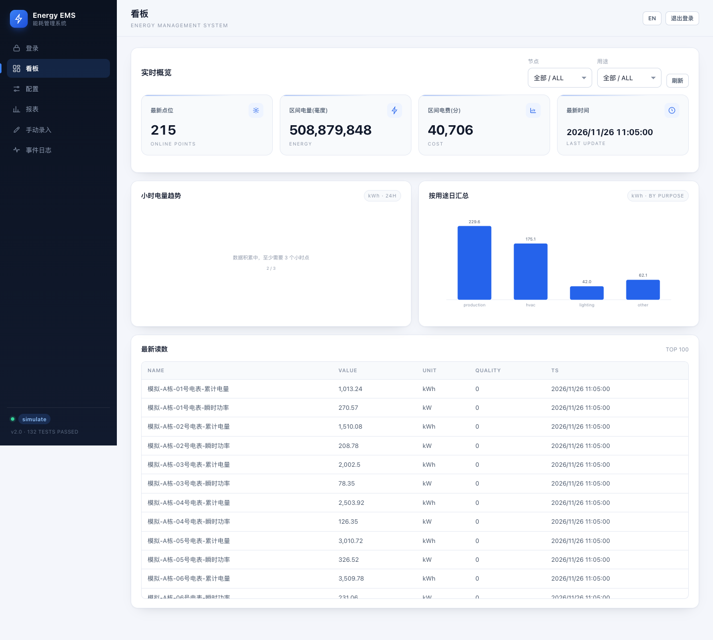
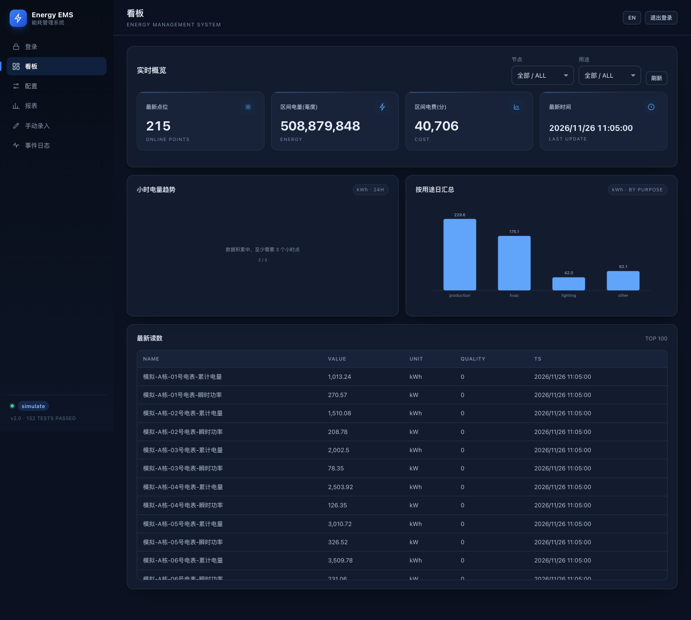
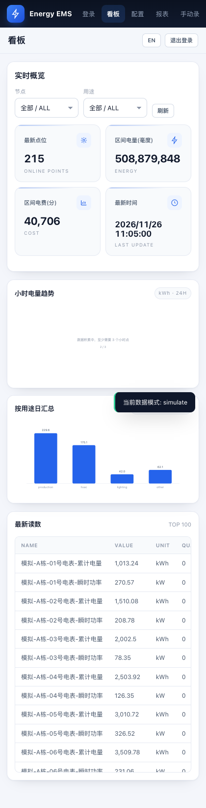

# Energy EMS · 轻量能源管理系统

[](LICENSE)
[](https://github.com/wanlong0117/energy-ems/actions/workflows/tests.yml)
[](https://github.com/wanlong0117/energy-ems/actions/workflows/build-windows.yml)
[](https://www.python.org/)
[](#快速开始)

> 一块工控机就能跑的能源管理系统：Modbus 直连、中文报表、零运维。
> A lightweight energy management system that runs on a single box — Modbus, Chinese-ready reports, zero ops.

---

## 为什么做这个项目

MyEMS 功能全但部署重（MySQL/Redis/MQ），OpenEMS 工业级但学习曲线陡。
中小工厂、园区、物业的真实需求往往只是：**几十到几百块表、看数、出报表、接 Modbus**，
而且现场只有 Windows，没有专职 IT。

Energy EMS 的取舍：

- **单进程 + SQLite**，不依赖任何外部服务
- **Windows 免安装包**，解压双击即用，不需要装 Python
- **自研 Modbus 三协议**，不引入 `pymodbus`
- **单文件看板**，零前端构建链，改样式不需要 npm
- **中文报表**，Excel / PDF 开箱可用

## 截图



| 暗色模式 | 移动端 |
|---|---|
|  |  |

## 功能

| 模块 | 说明 |
|---|---|
| 采集 | Modbus TCP、RTU-over-TCP、RTU 串口（自研实现，CRC16/MBAP 完整） |
| 规模 | 默认预置 100 块电表 + 5 组冷却塔电极 + 5 个机械排水手动点 |
| 数据 | 13 张表，SQLite WAL；读数质量分级（正常/超时/越界/人工） |
| 汇总 | 小时 / 日 / 周 / 月；日结算按本地 08:00（UTC 00:00）口径 |
| 报表 | 日/周/月聚合，Excel（openpyxl）与 PDF（ReportLab，内置中文字体） |
| 手动录入 | 机械排水量等离线数据补录，自动同步最新读数 |
| 看板 | 单文件 HTML，无框架、无构建；KPI、趋势、分项、最新读数 |
| 主题 | 亮/暗色自动跟随系统，860px 以下响应式 |
| 安全 | httponly 会话 cookie、首次登录强制改密、默认密码告警 |
| 演示 | `simulate` 模式内置模拟器，无硬件也能完整跑通 |

## 快速开始

### 方式 A：Windows 免安装包（推荐给现场）

1. 从 [Releases](../../releases) 下载 `energy-ems-win11-x64-<日期>.zip`
2. 解压到非中文、非 `C:\Program Files` 的目录，例如 `D:\energy_ems`
3. 双击 `energy_ems.exe`（`build_win11.bat` 为备用启动脚本）
4. 浏览器打开 <http://127.0.0.1:8000/>
5. 默认密码 `ems2026`，**首次登录会强制要求修改**

> 包内已含 Python 运行时与全部依赖（含 `VCRUNTIME140.dll`），无需联网、无需 pip。
> 端口固定 8000；如被占用，见 [FAQ](#faq)。

### 方式 B：源码运行

```bash
python -m venv .venv
# Windows
.venv\Scripts\pip install -r requirements.txt
.venv\Scripts\python main.py
# macOS / Linux
.venv/bin/pip install -r requirements.txt
.venv/bin/python main.py
```

打开 <http://127.0.0.1:8000/>。默认 `simulate` 模式，模拟器会立即写入 100 块表的读数。

### 方式 C：无人值守部署（可选）

首次生成配置时可用环境变量指定初始密码，避免默认密码：

```bash
EMS_PASSWORD='your-strong-password' ./energy_ems
```

> 该变量**仅在 `config.json` 不存在时生效**。之后改密请通过看板「配置 → 修改密码」，
> 密码会写入 `config.json` 并标记 `password_changed=true`。

## 配置

`config.json` 与 `energy_ems.exe` 同级（源码运行时为项目根目录），首次启动自动生成：

```json
{
  "password": "ems2026",
  "data_mode": "simulate",
  "simulate_interval_sec": 300,
  "simulate_rollup_sec": 600
}
```

| 字段 | 说明 |
|---|---|
| `password` | 登录密码（首次登录强制修改） |
| `data_mode` | `simulate` 内置模拟器 / `live` 真实 Modbus 采集，互斥 |
| `simulate_interval_sec` | 模拟器写读数间隔（秒） |
| `simulate_rollup_sec` | 模拟模式汇总间隔（秒） |

切换 `data_mode` 后需重启服务生效。

### Modbus 设备配置

看板「配置」页按资源类型维护 `node / device / point / meter / meter_point / tariff`。

| protocol | host | port | 说明 |
|---|---|---|---|
| `modbus_tcp` | 网关 IP | 502 | 标准 MBAP over TCP |
| `modbus_rtu_tcp` | 网关 IP | TCP 端口 | RTU 帧（地址 + PDU + CRC16）走 TCP |
| `modbus_rtu_serial` | `COM3` 等 | 波特率（9600/115200） | pyserial 串口，异步不阻塞 |
| `manual` | 任意 | 任意 | 手动表/机械表，不参与采集 |

点位试读（`POST /api/point/{id}/read`）会返回原始寄存器十六进制、解析值与四种字节序对照，
用于现场确认 `byte_order`（`ABCD / CDAB / BADC / DCBA`）。

## 架构

```
浏览器（单文件看板）
      │ HTTP
      ▼
FastAPI / Uvicorn（单进程）
  ├── api_auth      登录、会话、改密
  ├── api_config    7 类资源 CRUD + 点位试读
  ├── api_data      最新读数、小时/日/周/月
  ├── api_report    Excel / PDF 导出
  ├── collector     Modbus TCP / RTU-TCP / RTU 串口
  ├── simulator     演示数据（simulate 模式）
  └── aggregation   小时 / 日 / 周 / 月汇总
      │
      ▼
SQLite（WAL，13 张表）
```

目录：

```
energy-ems/
├── main.py              # 入口、lifespan、静态资源
├── auth.py              # 会话、密码策略
├── db.py                # SQLite 连接与事件日志
├── schema.sql           # 13 张表
├── modbus.py            # 自研 Modbus 三协议
├── collector.py         # 采集循环
├── simulator.py         # 模拟器
├── aggregation.py       # 聚合与结算
├── reports.py           # Excel / PDF
├── api_*.py             # 路由
├── dashboard/index.html # 单文件看板
├── tests/               # pytest
└── docs/                # PRD、架构、开源评估
```

## 测试

```bash
.venv/bin/python -m pytest -q
# 137 passed
```

覆盖：Modbus 帧解析（含 CRC16/字节序）、聚合口径、周/月报表、Excel/PDF 结构、
认证与密码策略、配置 CRUD、静态资源完整性。

## 安全

- 默认密码仅用于首次登录，**强制修改后才进入系统**
- 会话为 httponly + SameSite=Lax cookie，7 天过期
- 建议仅在内网使用；如需公网访问，请置于反向代理后并启用 HTTPS
- 漏洞上报请见 [SECURITY.md](SECURITY.md)

## FAQ

**Q：双击 exe 后窗口一闪而过？**
A：确认 zip 已完整解压（`energy_ems.exe` 与 `_internal/` 同级）；检查 Windows Defender
是否误删 exe（可加白名单后重新解压）。包内已含 `VCRUNTIME140.dll`，通常无需另装 VC++ 运行库。

**Q：端口 8000 被占用？**
A：在 exe 目录运行 `netstat -ano | findstr :8000`，按 PID 结束进程；
或使用端口转发：`netsh interface portproxy add v4tov4 listenport=8080 connectport=8000 connectaddress=127.0.0.1`。

**Q：看板没有数据？**
A：确认已登录；`simulate` 模式首屏会立即产数。若为空，检查 `energy.db` 是否可写、
「事件日志」是否有 `BASELINE_READY` / `SIMULATE_FAIL`。

**Q：PDF 中文乱码？**
A：使用 ReportLab 内置 `STSong-Light` CID 字体，无需外部字体；生僻字可能缺字，属正常。

## 路线图

- [x] v0.1 核心：采集、汇总、报表、看板、Win11 包
- [ ] Docker / compose（NAS、Linux 服务器）
- [ ] 多用户与角色权限（RBAC）
- [ ] 告警通知（邮件 / 企业微信 / 钉钉）
- [ ] MQTT / OPC UA 协议插件
- [ ] 演示站点与 5 分钟视频

## 贡献

欢迎 issue 与 PR。提交前请阅读 [CONTRIBUTING.md](CONTRIBUTING.md)，
并确保 `pytest` 全绿。安全问题请走私密渠道，见 [SECURITY.md](SECURITY.md)。

## 许可证

[MIT](LICENSE) © 2026 wanlong0117

可自由使用、修改、商用与闭源分发，只需在副本中保留版权声明与许可声明。
第三方依赖许可见 [THIRD_PARTY_NOTICES.md](THIRD_PARTY_NOTICES.md)。

## 免责声明

本软件用于辅助能源计量与统计。现场投运前请自行校验点位地址、数据类型、字节序与计量口径。
作者不对因配置错误、设备故障或数据偏差造成的生产或商业损失承担责任。
