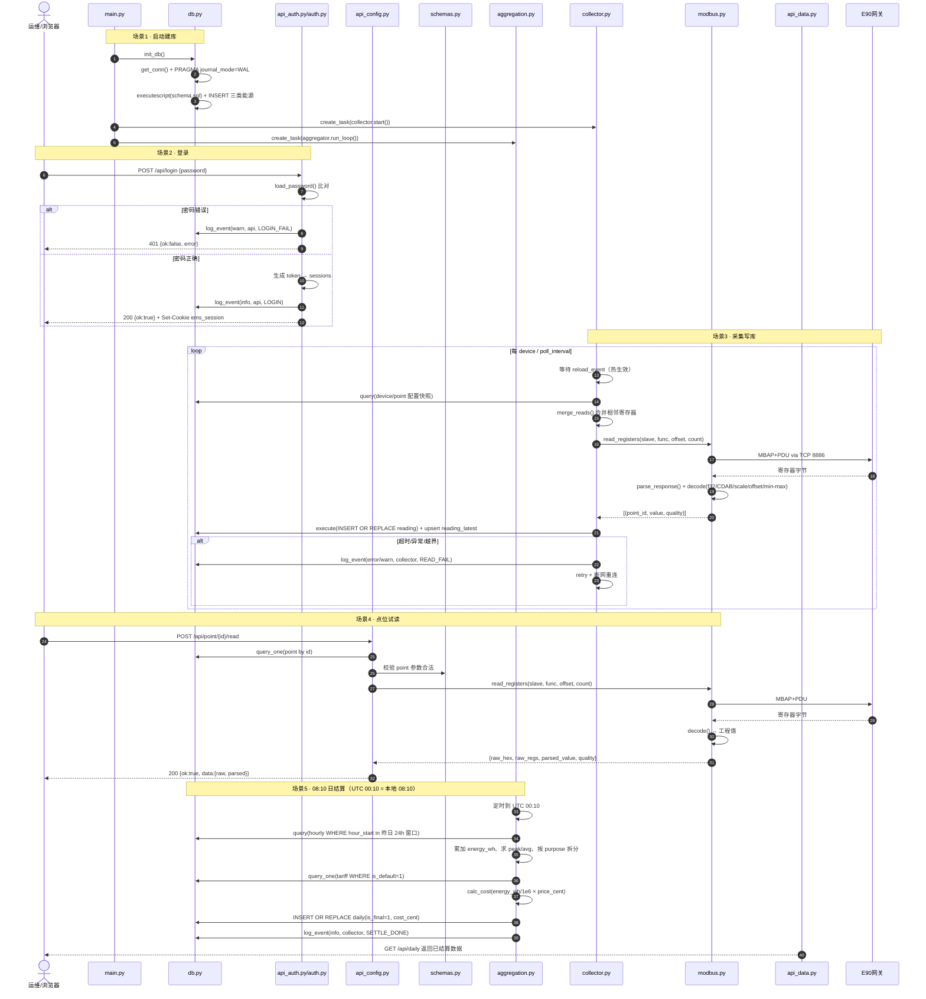
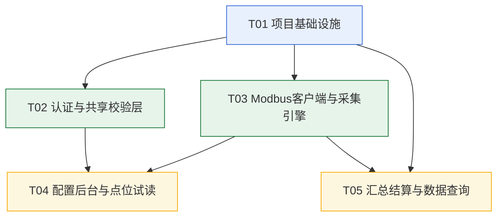

# 能耗管理系统 energy_ems · 系统设计与任务分解（Phase 0~3）

> 依据：`docs/PRD.md`、`schema.sql`（12 表）、`db.py`、`auth.py`、`requirements.txt` 与 IMA《自研能耗管理系统-替代MyEMS技术方案》v1.0 硬约束。
> 范围：Phase 0（建库服务）~ Phase 3（小时/日汇总与电费）；Phase 4 看板、Phase 5 报表、Phase 6 运维后置。
> 原则：**兼容复用现有实现，不推倒重写**；单进程 + 单 SQLite 文件 + 无重依赖。

---

# Part A · 系统设计

## 1. 实现方式（难点与选型）

### 1.1 核心难点

| 难点 | 说明 | 对策 |
|---|---|---|
| 自写 Modbus TCP 客户端 | 禁用 pymodbus，需在约 120 行内实现 MBAP 帧、func 3/4、事务 ID、超时/重试、断线重连 | `modbus.py`：基于 `asyncio.open_connection` 的最小实现，`build_adu`/`parse_response`/`read_registers` 三段式 |
| 寄存器解析与字序 | 吉特 ZK-3FHD3Y 为 f32 寄存器且可能 CDAB 字交换；需支持 u16/s16/u32/s32/f32/u64 与 ABCD/CDAB/BADC/DCBA | `modbus.py::decode()` 用 `struct` 组字节后按字节序重排再 unpack；试读接口现场验证 CDAB |
| 单连接并发 | `db.py` 全局单连接 `check_same_thread=False`；asyncio 单线程事件循环 | 所有 `db` 操作保持**同步短事务**，不在 await 之间持有游标；写库用 `execute()` 自带 commit |
| 寄存器合并读取 | 相邻寄存器逐点读会浪费往返 | `collector.merge_reads()` 按 (device, slave, func) 排序，把相邻/重叠区间合并为单次 ≤125 寄存器请求 |
| 配置热生效 | 修改 device/point 后不重启即生效 | `Collector.reload()` 置 `asyncio.Event`，轮询循环在每轮起点重建配置快照 |
| 08:00 结算口径 | 本地 08:00→次日 08:00，需与 UTC 存储换算 | 现场 UTC+8 ⇒ 08:00 本地 = UTC 00:00；`day_start` 存 UTC 00:00 时间戳，`hour_start` 存 UTC 整点，`08:10` 结算即 UTC 00:10 |
| 电量单位 | 累计电量差值需换算为毫度（1 kWh = 1,000,000） | `aggregation` 用 `ΔkWh × 1e6` 写 `energy_wh`；电费按小时电量乘对应时段单价（v0.1.2 起支持峰平谷），单一电价即 `energy_wh/1e6 × price_cent` |

### 1.2 框架与选型

- **Web/ASGI**：FastAPI + Uvicorn（现有依赖），单进程 `uvicorn main:app`。生命周期用 `@asynccontextmanager` 的 `lifespan` 启动后台任务。
- **存储**：原生 `sqlite3`（现有 `db.py`），仅 WAL 模式，无 ORM；主键/唯一约束保证幂等。
- **异步**：标准库 `asyncio`（无 aiohttp）——Modbus 用 `asyncio.open_connection`，定时用 `asyncio.sleep`。
- **校验**：Pydantic v2（FastAPI 自带依赖，显式声明），承载请求模型与点位保存校验规则。
- **前端**：本轮不实现看板；`main.py` 预留静态挂载 `/` 指向后续单文件 `index.html`（Phase 4）。
- **架构模式**：分层 —— 接入层（`api_*.py`）→ 服务层（`collector`/`aggregation`/`ConfigService`/`DataService`）→ 数据层（`db.py`/`schema.sql`）。全局配置常量集中在 `settings.py`。

### 1.3 明确不引入

Docker、微服务、ORM（SQLAlchemy）、Redis、MQ、pymodbus、角色权限、Vite/React/MUI/Tailwind。

---

## 2. 文件列表（相对 `energy-ems/`）

> 共 13 个源文件（含 3 个复用改造）。`config.json` 为运行时生成，非源码。

| # | 文件 | 状态 | 职责 |
|---|---|---|---|
| 1 | `requirements.txt` | 改造 | 新增 `pydantic>=2.5` 显式声明 |
| 2 | `settings.py` | 新建 | 全局常量：时区/08:00 口径、毫度换算、采集周期/超时/重试、结算时刻、8 个二进制因子表 |
| 3 | `main.py` | 新建 | FastAPI 入口、`lifespan`（init_db + 启动采集/结算后台任务）、路由注册、静态挂载、异常处理 |
| 4 | `schema.sql` | 复用·微调 | 12 表定义；修正 `point.byte_order` 默认值为 `ABCD`（现为 `AB`，与 PRD 4 字符格式不符） |
| 5 | `db.py` | 复用 | 全局单连接 + `init_db/query/query_one/execute/log_event`；本轮不改动核心 API |
| 6 | `auth.py` | 复用·改造 | 保留 `login/logout/current_user`；新增 `require_auth` FastAPI 依赖 |
| 7 | `schemas.py` | 新建 | Pydantic 请求模型 + `PointValidator`（点位保存校验规则） |
| 8 | `api_auth.py` | 新建 | `/api/login`、`/api/logout`、`/api/session` |
| 9 | `modbus.py` | 新建 | asyncio Modbus TCP 客户端 + `decode()` 寄存器解析（约 120 行） |
| 10 | `collector.py` | 新建 | 采集调度、合并读取、写 `reading`/`reading_latest`、重连、`reload()`、`probe_point()` |
| 11 | `aggregation.py` | 新建 | 小时汇总、日汇总（08:00 口径）、电费、purpose 分栋、定时结算 |
| 12 | `api_config.py` | 新建 | 7 类资源 CRUD、试读、连接测试、事件日志、采集重载 |
| 13 | `api_data.py` | 新建 | `latest/hourly/daily` 查询、手动触发结算、设备链路 `devices/link` |
| 14 | `link.py` | 新建（v0.1.10） | 设备链路状态判定（在线/断线/从未连通/停用/人工/演示），供 API 与日结共用 |

---

## 3. 数据结构与接口（Mermaid classDiagram）

> 同步保存于 `docs/class-diagram.mermaid`。

```mermaid
classDiagram
    direction TB

    %% ============ 数据模型（对应 schema.sql 12 表） ============
    class Node {
        +int id
        +str name
        +int parent_id
        +str kind
        +int sort_order
        +int is_active
    }
    class Device {
        +int id
        +str name
        +int node_id
        +str protocol
        +str host
        +int port
        +int timeout_ms
        +int retry
        +int poll_interval
        +int is_enabled
        +int last_ok_at
        +str last_error
    }
    class Point {
        +int id
        +str name
        +int device_id
        +int slave_id
        +int func_code
        +int reg_offset
        +int reg_count
        +str data_type
        +str byte_order
        +float scale
        +float offset_const
        +float min_val
        +float max_val
        +str unit
        +int is_demo
        +int is_enabled
    }
    class EnergyCategory {
        +int id
        +str name
        +str unit
    }
    class Meter {
        +int id
        +str name
        +int node_id
        +int category_id
        +str purpose
        +int is_counted
        +int is_demo
        +int is_enabled
        +float shutdown_power_w
    }
    class MeterPoint {
        +int meter_id
        +int point_id
        +str role
    }
    class Reading {
        +int point_id
        +int ts
        +float value
        +int quality
    }
    class ReadingLatest {
        +int point_id
        +int ts
        +float value
        +int quality
    }
    class Hourly {
        +int meter_id
        +int hour_start
        +int energy_wh
        +float avg_power
        +float max_power
        +int sample_cnt
    }
    class Daily {
        +int meter_id
        +int day_start
        +int energy_wh
        +float peak_power
        +float avg_power
        +int cost_cent
        +int covered_hours
        +int shutdown_hours
        +int is_final
    }
    class Tariff {
        +int id
        +str name
        +int price_cent
        +int start_hour
        +int end_hour
        +int is_default
    }
    class EventLog {
        +int id
        +int ts
        +str level
        +str source
        +str code
        +str message
        +int ref_id
    }

    %% ============ 服务层 ============
    class DB {
        +get_conn() Connection
        +init_db() None
        +query(sql, params) list
        +query_one(sql, params) Row
        +execute(sql, params) int
        +log_event(level, source, code, message, ref_id) None
    }
    class AuthService {
        +sessions dict
        +load_password() str
        +login(password, response) JSONResponse
        +logout(request) JSONResponse
        +current_user(request) bool
        +require_auth(request) bool
    }
    class PointValidator {
        +validate_reg_offset(v) int
        +validate_reg_count(v) int
        +validate_type_count(dt, count) None
        +check_overlap(device_id, slave_id, func_code, offset, count, exclude_id) None
    }
    class ModbusClient {
        +str host
        +int port
        +int timeout_ms
        +connect() None
        +close() None
        +build_adu(slave, func, offset, count) bytes
        +parse_response(data) list
        +read_registers(slave, func, offset, count) list
        +decode(registers, point) tuple
    }
    class Collector {
        +tasks dict
        +config_sig str
        +reload_event Event
        +start() None
        +poll_device(device) None
        +merge_reads(device, points) list
        +write_batch(rows) None
        +reload() None
        +probe_point(point_id) dict
    }
    class Aggregator {
        +rollup_hour(hour_start) None
        +settle_day(day_start) None
        +calc_cost(energy_wh, day_start) int
        +split_by_purpose(day_start) list
        +run_loop() None
    }
    class ConfigService {
        +list(resource) list
        +get(resource, id) dict
        +create(resource, body) dict
        +update(resource, id, body) dict
        +delete(resource, id) bool
        +validate_point(body) None
        +test_device(id) dict
    }
    class DataService {
        +latest(filters) list
        +hourly(filters) list
        +daily(filters) list
        +events(filters) list
    }

    %% ============ 接入层 ============
    class ApiAuth {
        +login(req) JSONResponse
        +logout(req) JSONResponse
        +session(req) dict
    }
    class ApiConfig {
        +crud(resource, id, method) dict
        +read_point(id) dict
        +test_device(id) dict
        +list_events(filters) list
        +reload_collector() dict
    }
    class ApiData {
        +latest(filters) list
        +hourly(filters) list
        +daily(filters) list
        +settle(day_start) dict
    }
    class Main {
        +app FastAPI
        +lifespan() None
        +mount_routes() None
    }

    %% ============ 关系 ============
    Node "1" -- "0..*" Device : 包含
    Node "1" -- "0..*" Meter : 归属
    EnergyCategory "1" -- "0..*" Meter : 分类
    Device "1" -- "0..*" Point : 采集点
    Meter "1" -- "0..*" MeterPoint : 关联
    Point "1" -- "0..*" MeterPoint : 关联
    Point "1" -- "0..*" Reading : 时序值
    Point "1" -- "0..1" ReadingLatest : 最新值
    Meter "1" -- "0..*" Hourly : 小时汇总
    Meter "1" -- "0..*" Daily : 日汇总
    Tariff "1" -- "0..*" Daily : 计费

    Main --> ApiAuth
    Main --> ApiConfig
    Main --> ApiData
    Main --> Collector
    Main --> Aggregator
    ApiAuth --> AuthService
    ApiConfig --> ConfigService
    ApiConfig --> Collector
    ApiConfig --> ModbusClient
    ApiData --> DataService
    ApiData --> Aggregator
    ConfigService --> PointValidator
    ConfigService --> DB
    DataService --> DB
    AuthService --> DB
    Collector --> ModbusClient
    Collector --> DB
    Aggregator --> DB
```



### 3.1 关键接口签名（伪代码）

```python
# modbus.py —— 自写客户端核心（约 120 行）
class ModbusClient:
    def __init__(self, host: str, port: int, timeout_ms: int, retry: int): ...
    async def connect(self) -> None: ...                # asyncio.open_connection
    async def close(self) -> None: ...
    def build_adu(self, slave: int, func: int, offset: int, count: int) -> bytes: ...  # MBAP+PDU
    def parse_response(self, data: bytes) -> list[int]: ...  # 校验 func/字节数，解 >H
    async def read_registers(self, slave: int, func: int, offset: int, count: int) -> list[int]: ...  # 超时/重试
    def decode(self, registers: list[int], point: dict) -> tuple[float, int]: ...  # data_type+byte_order+scale+offset+min/max → (value, quality)
```

```python
# schemas.py —— 点位保存校验规则（硬性）
TYPE_COUNT = {"u16": 1, "s16": 1, "u32": 2, "s32": 2, "f32": 2, "u64": 4}

def validate_point(body: dict, exclude_id: int | None = None) -> None:
    assert 0 <= body["reg_offset"] <= 65535          # reg_offset 范围
    assert 1 <= body["reg_count"] <= 125             # reg_count 范围
    assert body["reg_count"] == TYPE_COUNT[body["data_type"]]  # 类型与寄存器数匹配
    assert body["byte_order"] in {"ABCD", "CDAB", "BADC", "DCBA"}
    assert body["func_code"] in {3, 4}
    # 同设备 + 同从站 + 同 func 的寄存器区间不得重叠
    rows = DB.query("SELECT id, reg_offset, reg_count FROM point WHERE device_id=? AND slave_id=? AND func_code=?",
                    (body["device_id"], body["slave_id"], body["func_code"]))
    s, e = body["reg_offset"], body["reg_offset"] + body["reg_count"]
    for r in rows:
        if r["id"] == exclude_id:
            continue
        rs, re = r["reg_offset"], r["reg_offset"] + r["reg_count"]
        assert not (s < re and rs < e), "寄存器区间重叠"
```

```python
# collector.py —— 合并读取与热生效
def merge_reads(self, device: dict, points: list[dict]) -> list[dict]: ...
# 按 (slave_id, func_code) 分组、按 reg_offset 排序，把相邻/重叠区间合并为单次请求（≤125 寄存器）

def reload(self) -> None: self.reload_event.set()   # 配置变更后调用
```

```python
# aggregation.py —— 08:00 口径与电费
def rollup_hour(self, hour_start: int) -> None: ...   # Δ累计电量×1e6 → hourly.energy_wh；power 点求 avg/max
def settle_day(self, day_start: int) -> None: ...     # 24 个 UTC 小时汇总求和 → daily(is_final=1)
def calc_cost(self, energy_wh: int, day_start: int) -> int: ...  # energy_wh/1e6 × price_cent
```

### 3.2 HTTP 端点清单（Phase 0~3）

| 方法 | 路径 | 说明 | 认证 |
|---|---|---|---|
| POST | `/api/login` | 固定密码登录，Set-Cookie | 否 |
| POST | `/api/logout` | 登出 | 是 |
| GET | `/api/session` | 会话状态 | 否 |
| GET | `/api/config/{resource}` | 列表；resource ∈ node/device/point/energy_category/meter/meter_point/tariff | 是 |
| GET | `/api/config/{resource}/{id}` | 单条 | 是 |
| POST | `/api/config/{resource}` | 新增（含点位校验） | 是 |
| PUT | `/api/config/{resource}/{id}` | 更新（含点位校验 + 触发 reload） | 是 |
| DELETE | `/api/config/{resource}/{id}` | 删除 | 是 |
| POST | `/api/point/{id}/read` | 点位试读：3 秒内返回原始寄存器 hex + 解析值 | 是 |
| POST | `/api/device/{id}/test` | 设备连接测试 | 是 |
| POST | `/api/collector/reload` | 采集配置热生效 | 是 |
| GET | `/api/events` | 事件日志（level/source/limit/since 过滤） | 是 |
| GET | `/api/latest` | 最新读数（point_id/meter_id 过滤） | 是 |
| GET | `/api/hourly` | 小时汇总（meter_id/from/to/purpose/node_id） | 是 |
| GET | `/api/daily` | 日汇总（meter_id/from/to/purpose/node_id/is_final） | 是 |
| POST | `/api/settle` | 手动触发日结算（body: day_start 可选） | 是 |

---

## 4. 程序调用流程（Mermaid sequenceDiagram）

> 同步保存于 `docs/sequence-diagram.mermaid`。覆盖：启动建库、登录、采集写库、点位试读、08:10 日结算。



---

## 5. Anything UNCLEAR（假设与待确认）

1. **时区/08:00 口径**：现场默认 UTC+8，故本地 08:00 = UTC 00:00。v0.1.2 起日切点与
   时区偏移可用 `EMS_DAY_START_HOUR` / `EMS_TZ_OFFSET_HOURS` 配置，默认值保持 UTC 00:00 口径。
2. **byte_order 默认值**：`schema.sql` 现为 `DEFAULT 'AB'`（2 字符），与 PRD 的 4 字符格式 `ABCD/CDAB/BADC/DCBA` 冲突。设计按 4 字符统一，初始化时修正默认值为 `ABCD`。
3. **CDAB 字交换**：现场电表是否确为 CDAB 未最终确认；试读接口返回原始寄存器 hex + 多种字节序解析值供现场比对确认。
4. **tariff 峰平谷**：v0.1.2 已实现——按当天各小时电量匹配 `start_hour/end_hour` 时段单价，
   未覆盖时段回退 `is_default` 单一电价；日表另存加权单价与时段快照（`price_cent`/`tariff_snapshot`）。
5. **网关连接与并存**：采集机 MyEMS 是否并行运行、E90 网关连接数上限未知；自写客户端每设备独立短连接，读毕即关。
6. **累计电量取点**：小时电量差取 `meter_point.role='reading'` 的点；瞬时功率取 `role='power'`。若某表未配置 power 点，`avg_power/max_power` 允许为 NULL。
7. **90 天清理/看板/CSV**：`reading` 90 天滚动清理与单文件看板已在 v0.1.x 落地；
   报表导出走 Excel/PDF（CSV 未提供）。
8. **固定密码修改**：已提供网页改密入口（`POST /api/password`），并支持服务端强制改密与失败锁定。

---

# Part B · 任务分解

## 6. Required Packages

```
- fastapi>=0.110        # Web 框架（现有）
- uvicorn>=0.29         # ASGI 服务器（现有）
- pydantic>=2.5         # 请求校验与点位保存规则（FastAPI 自带依赖，显式声明）
```
标准库：`asyncio` / `sqlite3` / `struct` / `socket`（由 asyncio 封装）/ `json` / `secrets` / `time` / `datetime` / `pathlib`。
**不新增** pymodbus、aiohttp、SQLAlchemy、redis 等任何重依赖。

---

## 7. Task List（按依赖排序）

### T01 · 项目基础设施
- **Source Files**：`requirements.txt`（改造）、`settings.py`（新建）、`main.py`（新建骨架）、`schema.sql`（复用·修正 byte_order 默认值）、`db.py`（复用接入）
- **Dependencies**：无
- **Priority**：P0
- **要点**：集中常量（UTC+8、08:00 口径、1e6 换算、采集周期、超时/重试、结算时刻、字节序因子表）；`lifespan` 调用 `init_db()` 并启动后台任务；路由注册骨架与静态挂载位。

### T02 · 认证与共享校验层
- **Source Files**：`auth.py`（改造，新增 `require_auth`）、`api_auth.py`（新建）、`schemas.py`（新建，Pydantic 模型基础）
- **Dependencies**：T01
- **Priority**：P0
- **要点**：保留现有 session cookie 机制；3 个认证端点；请求模型与统一响应辅助。

### T03 · Modbus 客户端与采集引擎
- **Source Files**：`modbus.py`（新建）、`collector.py`（新建）、`settings.py`（复用采集参数）
- **Dependencies**：T01
- **Priority**：P0
- **要点**：自写 MBAP 客户端（func 3/4、超时/重试）；5 种 data_type × 4 种 byte_order 解析；相邻寄存器合并；写 `reading`/`reading_latest`；断网重连与 `reload()` 热生效。

### T04 · 配置后台与点位试读 API
- **Source Files**：`api_config.py`（新建）、`schemas.py`（改造，点位校验规则完整实现）、`collector.py`（复用 `reload()`/`probe_point()`）
- **Dependencies**：T01, T02, T03
- **Priority**：P0
- **要点**：7 类资源 CRUD；点位保存四条硬校验；试读/连接测试 3 秒返回；事件日志；配置变更后触发热生效。

### T05 · 汇总结算与数据查询 API
- **Source Files**：`aggregation.py`（新建）、`api_data.py`（新建）、`main.py`（改造，接入结算定时任务）
- **Dependencies**：T01, T03
- **Priority**：P0
- **要点**：小时汇总与 08:00 口径日结算；电费与 purpose 分栋；`latest/hourly/daily` 查询；手动触发结算；UTC 00:10 定时结算循环。

---

## 8. Shared Knowledge（跨文件共享约定）

- **API 响应格式**：统一 `{ "ok": bool, "data"?: any, "error"?: str }`。成功仅业务数据时可省略 `data`；失败带 `error` 并设置 HTTP 状态码。兼容现有 `auth.py` 的 `{"ok":true}` / `{"ok":false,"error":"密码错误"}`。
- **认证**：session cookie 名 `ems_session`，httponly、samesite=lax、TTL 7 天；除 `/api/login`、`/api/session` 外所有 `/api/*` 经 `require_auth` 守卫，未登录返回 401。token → 过期时间戳存内存 `_sessions`（重启失效）。
- **时间单位**：所有时间戳为 Unix 秒（UTC）。本地 UTC+8：`day_start` = 当日 UTC 00:00（= 本地 08:00）；`hour_start` = UTC 整点；08:10 自动结算 = UTC 00:10。DB 不存本地时间字符串。
- **电量单位**：`energy_wh`/`cost_cent` 为整数；1 kWh = 1,000,000 毫度；电费 `cost_cent = round(energy_wh / 1e6 × price_cent)`。`reading.value` 为经 `scale`/`offset_const` 换算后的工程值，单位见 `point.unit`。
- **小时电量取窗（关键）**：累计电量点用**左开右闭**区间 `(hour_start, hour_end]`——`base = ts <= hour_start` 的最后一条、`end = hour_start < ts <= hour_end` 的最后一条。相邻小时首尾相接，24 小时合计严格等于首末日读数差。**不要**改成 `[hour_start, hour_end)`：整点读数只被下一小时当基准，本小时收口取不到，每小时固定少计一个采样间隔（300s 约 8.3%）。功率点与 `sample_cnt` 仍用 `[hour_start, hour_end)`，因为瞬时值归入本小时的采样。窗口内没有任何有效读数时**不产出** `hourly` 行（掉线不能记成 0 电量）。
- **结算定稿门槛**：表覆盖（有数据的表数 / 应结算表数 ≥ 90%）决定整日，小时覆盖（该表当日有数据的小时数 / 24 ≥ 90%）**逐表**决定；不达标的表单独 `is_final=0` 并记 `SETTLE_METER_INCOMPLETE`。不要用全局小时并集判定——那拦不住「99 块表满、1 块只有 1 小时」。
- **点位校验（硬性）**：`reg_offset` ∈ [0,65535]；`reg_count` ∈ [1,125]；`data_type`↔`reg_count` = u16/s16:1、u32/s32/f32:2、u64:4；`func_code` ∈ {3,4}；`byte_order` ∈ {ABCD,CDAB,BADC,DCBA}；同 device + 同 slave + 同 func 的 `[reg_offset, reg_offset+reg_count)` 区间不得与已有记录重叠（更新时排除自身 id）。
- **演示数据隔离（关键）**：`node`/`device`/`point`/`meter` 带 `is_demo` 标记。只要存在一块「真实且启用」的表（`is_enabled=1 AND is_counted=1 AND is_demo=0`），所有汇总与查询都要经 `db.demo_guard()` 追加 `AND is_demo=0`；否则演示表会被计入覆盖率分母，把真表当天的定稿率从 100% 压到 1/101。切 live 时启动阶段调 `db.disable_demo_data()` 停用演示实体而不是删除——现场需要能回看演示库长什么样。
- **手工补录的重算范围**：补录落在整点（`ts == hour_start`）时必须连带重算**上一小时**——左开右闭窗口下，整点读数同时是上一小时的收口基准；同时重算所属日的日报。只写新行不改旧行，就是「补录成功了但报表没动」的经典事故。
- **停机判定与覆盖率分母**：某个小时 `hourly.avg_power` 低于阈值即判为停机，覆盖分母取 `24 − 停机小时`，**分子同源取「有数据且非停机」的小时数**（整日停机时无应有生产小时，直接放行，使 0 度停产日也能定稿）。阈值逐表解析：`meter.shutdown_power_w` 优先，`NULL` 回退全局 `EMS_SHUTDOWN_POWER_W`，`0` 表示关闭。缺口推断有界：缺口左右两侧最近的有数据小时都判停机、且连续长度 ≤ `EMS_SHUTDOWN_GAP_MAX_HOURS`（默认 3）时才按停机算，日界缺口与长缺口不推断。四条不能松的口子：① 只认有功率读数的小时——采不到数据不能算停机，否则「采集断了」会被伪装成「停机」；② 分子分母同源，只剔分母会让比值被放大（12 小时待机 + 12 小时生产全缺也能算出 1.0 并定稿）；③ 停机只改覆盖率口径，不改电量与电费；④ 无数据的小时默认仍计入分母，只有满足缺口推断条件才豁免。结算结果把 `shutdown_hours` 落到 `daily`，并记 `SETTLE_SHUTDOWN` 事件，供事后解释「为什么这天定稿了」。
- **累计值回退三分支（v0.1.9，关键）**：`end - base < 0` 时不能一律记 0。① 配了 `meter.max_reading_kwh` 且新旧读数都在 `[0, 量程]` 内 → 按 `(量程 − 旧值) + 新值` 补回，记 `METER_ROLLOVER`；② 否则用「本小时窗口内首条读数」当新基准重算，记 `METER_SWAP`（换表；要求该首条严格晚于 `base` 且不大于 `end`，算出的值必须 ≥ 0 且小于量程）；③ 都不成立才按 0 计并记 `METER_RESET`。返回值恒 ≥ 0，任何分支都不许把负电量写进 `hourly`。量程默认 `NULL`（不修正）：错填量程会让一次换表被算成「翻了半圈」，产出几十万度假电量，比少计更难收拾。
- **串口总线互斥（v0.1.9，关键）**：`modbus.py` 的 `_serial_port_locks` 按端口（`os.path.normcase` 归一，跨客户端实例共享）串行化整个 `read_registers`（含重试），并在发帧前用 `_serial_last_io` 补足 3.5 字符帧间静默。原因：一根 485 总线挂多台从站时，两帧交错写进同一根线**不会报错**——同总线上确实有该站，CRC 与站号校验都能通过，表现为「某表读数偶尔乱跳」。新增协议客户端时必须复用这把锁，不要各自开锁。
- **断电/断线不算停机（v0.1.10，关键）**：缺口推断（上一条）会把「夹在两段停机之间的短缺口」按停机算，这对**设备在线、只是这台表没数据**的场景是对的，对**整台设备断电**就是错的——后者是断线，不是停产，把它豁免掉等于给一次断电发了「已结算」证书。因此结算时对每块表再做一次核对：`Aggregator._device_silent_hours(meter_id, day_start)` 查该表所属设备当日各小时是否**一个有效读数都没有**（只认 `quality IN (0,3)`；采集失败补的 `quality=1` 保持值恰恰是「没读到」的证据，不能算有数据），静默小时从缺口推断里扣掉。这条只在「存在停机小时且当日有缺口」时触发，一次结算通常只有少数几块表会查库。
- **链路状态（v0.1.10）**：`link.py` 把 `device.last_ok_at` 与 `reading_latest` 最新时间取**较晚者**，按 `poll_interval × 3`（夹在 [120s, 3600s]）判 `online/offline`，另有 `never`（从未成功）、`disabled`、`manual`、`demo` 四档。只认 `last_ok_at` 会让模拟实例整片显示「从未连通」（模拟器不写该字段），只用最新读数又会让「刚加点位还没读数」的健康设备误判断线。对外暴露为 `GET /api/devices/link`，看板「设备链路」卡片直接消费。
- **负功率记异常（v0.1.10）**：功率点（`meter_point.role='power'`）的负值记 `quality=2` 并留 `POWER_NEGATIVE`，原值照常入库供现场识别反接。必须只在 power 角色上做：累计电量点的回退是翻转/换表，有 `METER_*` 那套处置，统一按负值拦截会把换表路径堵死。判定所需的 `is_power` 由 point 查询里的 `EXISTS(meter_point ...)` 带出，不额外查库。
- **打包入口契约（关键，v0.1.8）**：`main.py` 的启动必须是 `uvicorn.run(app, host, port, workers=1)`，**绝不能**写成 `uvicorn.run("main:app", ...)`。PyInstaller 冻结后入口脚本在 `sys.modules` 里只注册为 `__main__`，不存在名叫 `main` 的可导入模块，按名字导入会抛 `Could not import module "main"` 并以退出码 3 结束——源码运行完全正常，只有打包产物坏，所以单测发现不了。两层防线：`tests/test_entrypoint.py` 用 AST 断言首参是 `app` 对象且 `workers ≤ 1`；CI 打包后真正启动 exe 并请求 `/healthz`，非 200 即构建失败。同理不要用「在 exe 目录放一个 main.py 存根」来绕——那依赖运行时 cwd 在 `sys.path` 里，换个启动方式（计划任务/服务/快捷方式）又会失效。
- **quality**：0=正常、1=超时、2=越界（超出 min/max，或功率点为负）、3=人工。电量统计取 0 与 3，功率统计只取 0。
- **单一连接**：`db.py` 全局连接、`check_same_thread=False`；所有 DB 调用同步短事务，`execute()` 内 commit，避免在 `await` 间持有游标。
- **事务边界（v0.1.9，关键）**：`db.transaction()` 在**独立连接**上 `BEGIN IMMEDIATE`，并全程持有进程内 `_lock`。因此：① 块内**不得**调用 `db.execute` / `db.log_event`——同一线程会把自己堵死，卡满 `busy_timeout`（5 秒）后报 `database is locked`（旧注释写的「可继续调用不会自锁」是错的）；要写就用块内的 `conn`，要记审计用 `db.log_event_on(conn, ...)`。② 块内 `db.query` 能读但要意识到读到的是**事务外快照**。③ 不支持嵌套 `transaction()`。两条误用现在都直接抛 `RuntimeError`（线程内标记 `_txn_state`），不再用 5 秒卡顿当提示。④ 反过来，不要为了「原子」把分钟级批处理包成一个大事务：那会让采集写 `reading` 连吃 `busy_timeout` 失败，宁可写成「按批提交 + 可重跑」。
- **串口校验位（v0.1.9）**：`device.parity`（N/E/O，默认 N）经 `_client_for()` 透传给 `ModbusRTUSerialClient`。现场 8E1 的表把校验位写死成 N 时一帧都收不到，现象与接线/波特率错误无法区分，所以必须可配。串口的 `connect()` 是**真开一次端口**（供连接测试用），采集路径不用它——每帧自己开合，多一次探测纯属浪费。
- **采集侧不阻塞事件循环（v0.1.9）**：`poll_device` 里的点位查询、保底补点、`write_batch`、设备状态更新全部经 `asyncio.to_thread`。它们都是毫秒级短查询，但共用全局连接 + 进程内锁：报表导出/日结补算持锁期间，在事件循环线程等锁会把整个循环按住（`/healthz` 变慢、其它设备一起停摆）。
- **寄存器合并**：同 (device, slave, func) 按 offset 排序，相邻/重叠合并为单次请求，单次 `reg_count ≤ 125`，超限拆分。
- **幂等**：写库用 `INSERT OR REPLACE`（`reading` 主键 point_id+ts，`daily`/`hourly` 各自复合主键），保证重跑不重复。
- **事件日志**：`log_event(level, source, code, message, ref_id)`，source 取值 collector/api/user；登录失败、采集失败、结算完成均写日志。

---

## 9. Task Dependency Graph


