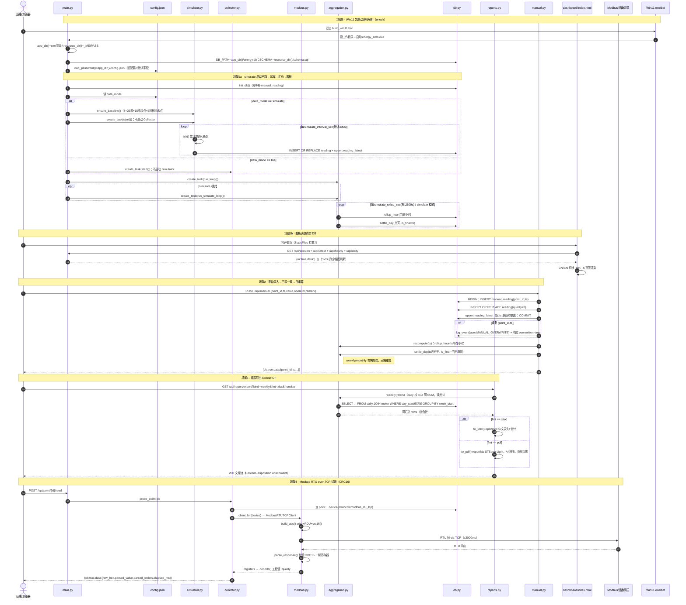
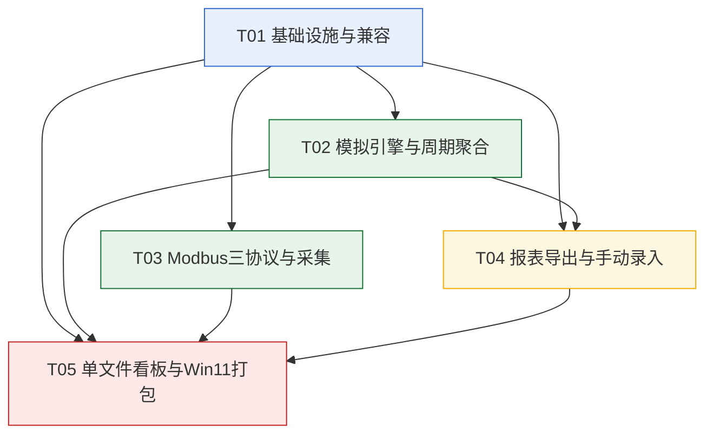

# 能耗管理系统 energy_ems · 增量系统设计与任务分解（v2）

> 依据：`docs/PRD_v2.md`（本轮权威需求）、`docs/PRD.md` / `docs/system_design.md`（v1 基线，13 源文件 + 12 表 + 74 项测试全绿）、现有代码实测。
> 范围：相对 v1 的**增量**——补齐 Phase 4 看板 / Phase 5 报表 / Phase 6 运维打包，并扩展模拟数据、周/月汇总、Excel/PDF、手动录入、冷却塔电极、三类 Modbus。
> 原则：**兼容存量、不推倒重写**；沿用单进程 + 单 SQLite + 单网页；所有看板/报表/API 一律读真实 DB，**代码中无 mock 分支**。
> 说明：本文件不覆盖 v1 设计，仅描述新增与变更；v1 已实现部分继续有效。

---

# Part A · 系统设计

## 1. 实现方式（难点与选型）

### 1.1 核心难点与对策

| 难点 | 说明 | 对策（落点） |
|---|---|---|
| 模拟/真实双模式共用一套数据链 | simulate 与 live 必须共用 API/看板/报表，禁止假数据分支 | `config.json.data_mode`（默认 `simulate`）；`main.lifespan` 按模式**二选一**启动 `Simulator` 或 `Collector`，`Aggregator` 两模式都启；模拟器直接写真实表 `reading`/`reading_latest`。切模式写配置 + 提示重启（明确、可靠） |
| 100 电表 + 5 冷却塔电极预置 | 需开箱即有一份可直接演示的配置与数据 | `Simulator.ensure_baseline()` 首次启动检查 point/meter 数量，不足则补齐：4 栋 × 25 表（purpose 混合 production/hvac/lighting/other），每表 reading+power 2 点；5 个机械排水量手动点挂 `protocol=manual` 的独立 device；电极 5 组 × 3 点（电导率 f32 μS/cm、电流 f32 A、排污阀 u16）用现有 node/device/point/meter 表达，不新增业务表 |
| 三类 Modbus 采集 | MBAP TCP、RTU 帧走 TCP（CRC16）、串口 COM（pyserial），仍禁 pymodbus | `modbus.py` 抽象 `BaseModbusClient` + 三实现：`ModbusTCPClient`（保留现 MBAP 逻辑）、`ModbusRTUTCPClient`（RTU ADU + CRC16 校验，走 TCP）、`ModbusRTUSerialClient`（pyserial 读 COM）；`Collector._client_for(device)` 按 `device.protocol` 分派，共用 `merge_reads`/`decode`/`write_batch` |
| 周/月按需聚合 | 不新增物化表，结果与区间 daily 求和误差 0 | `Aggregator` 新增 `weekly()`/`monthly()` helper：`day_start` 已是 UTC 00:00，按 ISO 周（周一为首）与自然月 1 日分组，对 `daily` 做 `SUM(energy_wh)/SUM(cost_cent)`；`api_data` 增两个端点，复用 purpose/node/meter 过滤 |
| Excel / PDF 中文导出 | 随包打包、无需另装字体 | `reports.py`：`openpyxl` 生成 .xlsx；`reportlab` 生成 .pdf，中文用内置 `STSong-Light` CID 字体（`UnicodeCIDFont`），不依赖外部字体文件；A4 横版，页眉“能耗管理系统 / Energy EMS”，页脚生成时间 + 页码 |
| 手动录入回填 | 机械排水量历史 ts 补录后需三表一致且进入报表 | `ManualService.record()` 在**单事务**内写 `manual_reading` + `reading(quality=3)` + `reading_latest`，随后触发受影响 `hour_start`/`day_start` 的 `rollup_hour` + `settle_day` 重算；weekly/monthly 因按需聚合无需重算；重复 (point_id, ts) 覆盖并写审计 |
| PyInstaller frozen path | 源码 `__file__` 指向临时解压目录，config/DB 会丢 | 双路径规则：可写数据（config.json、energy.db）→ `app_dir()`（frozen = `sys.executable.parent`，源码 = 项目根）；只读资源（schema.sql、dashboard）→ `resource_dir()`（frozen = `sys._MEIPASS`，源码 = 项目根）。`db.py`/`auth.py`/`settings.py` 统一改造，消除 `BASE_DIR` 双处定义 |
| 单文件前端离线 | 无外链、离线可开、CN/EN 全覆盖 | `dashboard/index.html` 内联 CSS/JS、SVG 自绘折线/柱图，不引 Chart.js/CDN；`StaticFiles` 挂载 `/`；右上角 CN/EN 通过 `i18n` 字典切换全部文案；6 页签对应现有 + 新增 API |
| 看板“有数” | 模拟器 5 分钟一写，聚合要保证小时/日有值 | 模拟模式 `Aggregator.run_simulate_loop()` 每 10 分钟 `rollup_hour(当前小时)` + `settle_day(当天, is_final=0)`；正式 UTC 00:10 结算昨日 `is_final=1`；`settle_day` 增加 `is_final` 参数。live 模式不启模拟器、simulate 模式不启采集器，避免主键冲突 |
| 旧测试零回归 / 旧库升级 | 74 项测试全绿；旧库不能丢数据 | `schema.sql` 仅增 `CREATE TABLE IF NOT EXISTS manual_reading`，`init_db` 幂等重跑即补表；所有改造保持既有函数签名与响应格式（`ok`/`fail`）；新增能力以增量方式挂载 |

### 1.2 框架与选型

- **Web/ASGI**：FastAPI + Uvicorn（`workers=1`），`lifespan` 按 `data_mode` 编排后台任务。
- **存储**：原生 `sqlite3` + WAL，全局单连接 `check_same_thread=False`；所有 DB 操作同步短事务，不在 `await` 之间持有游标。
- **寄存器解析**：沿用 `settings.BYTE_ORDER_FACTORS`（u16/s16/u32/s32/f32/u64 × ABCD/CDAB/BADC/DCBA），`modbus.decode()` 三客户端共用。
- **异步**：标准库 `asyncio`；仅 `ModbusRTUSerialClient` 用 `pyserial` 同步串口，包装在 `asyncio.to_thread` 中不阻塞事件循环。
- **报表**：`openpyxl`（.xlsx）+ `reportlab`（.pdf，内置 CID 中文字体）。
- **打包**：PyInstaller `onedir`，`energy-ems.spec` 声明 `datas`（schema.sql、dashboard/index.html）；GitHub Actions `windows-latest` runner 产出 zip artifact。
- **前端**：单个 `dashboard/index.html`，原生 JS + 内联 SVG，无构建步骤。
- **架构模式**：分层——接入层（`api_*.py`）→ 服务层（`Simulator`/`Collector`/`Aggregator`/`ManualService`/`ReportService`/`ConfigService`/`DataService`）→ 数据层（`db.py` + `schema.sql`）。

### 1.3 明确不引入

Docker、微服务、ORM、Redis/MQ、pymodbus、aiohttp、角色权限、Vite/React/MUI/Tailwind、Chart.js 及任何前端外链。

---

## 2. 文件列表（相对 `energy-ems/`）

> 产品源文件共 **22 个**（含新增 9 个，≤30 上限）；测试文件单列、不计入源文件额度。标注：〔新〕新建 /〔改〕改造 /〔复用〕不改动。

| # | 文件 | 状态 | 职责 |
|---|---|---|---|
| 1 | `requirements.txt` | 〔改〕 | +`openpyxl`/`reportlab`/`pyserial`；`pyinstaller` 列为构建期依赖 |
| 2 | `settings.py` | 〔改〕 | 统一 `app_dir()`/`resource_dir()`（frozen path）；`data_mode`/`simulate_interval_sec`/`simulate_rollup_sec`；周月口径常量；复用既有常量 |
| 3 | `main.py` | 〔改〕 | `lifespan` 按 `data_mode` 二选一启 `Simulator`/`Collector`；注册 `api_report`；静态挂载 `dashboard`；异常兜底复用 |
| 4 | `schema.sql` | 〔改〕 | +`manual_reading`（第 13 表）；`device.protocol` 注释补 `modbus_rtu_serial`/`manual` |
| 5 | `db.py` | 〔改〕 | `DB_PATH`/`SCHEMA_PATH` 走新路径解析；`init_db` 幂等补表；核心 query/execute 不变 |
| 6 | `auth.py` | 〔改〕 | `CONFIG_PATH` 走 `app_dir()`；`load_password()` 扩展默认 `data_mode`/`simulate_*` 并对旧 config 补缺省字段 |
| 7 | `schemas.py` | 〔改〕 | `DeviceIn.protocol` 枚举扩 3 类 + `manual`；新增 `ManualIn`/`ReportQueryIn`/`ModeIn` 模型 |
| 8 | `api_auth.py` | 〔复用〕 | 认证 3 端点不变 |
| 9 | `modbus.py` | 〔改〕 | 抽象 `BaseModbusClient` + `ModbusTCPClient`/`ModbusRTUTCPClient`/`ModbusRTUSerialClient`；CRC16；`decode()` 复用 |
| 10 | `collector.py` | 〔改〕 | 按 `protocol` 分派客户端；三协议互斥于模拟器；`merge_reads`/`write_batch`/`probe_point` 复用 |
| 11 | `aggregation.py` | 〔改〕 | +`weekly()`/`monthly()` 聚合 helper；`settle_day(is_final=...)`；`run_simulate_loop()` |
| 12 | `api_config.py` | 〔复用/微调〕 | 协议校验随 schemas 生效；其余 CRUD/试读不变 |
| 13 | `api_data.py` | 〔改〕 | +`GET /api/weekly`、`GET /api/monthly`、`GET /api/mode` |
| 14 | `simulator.py` | 〔新〕 | 100 电表 + 5 冷却塔电极基线预置；5 分钟产数写真实表；累计单调；可配频率 |
| 15 | `reports.py` | 〔新〕 | `ReportService`：日/周/月数据组装；`to_xlsx()` / `to_pdf()` |
| 16 | `manual.py` | 〔新〕 | `ManualService.record()/list()`；事务三表一致 + 回填重算 |
| 17 | `api_report.py` | 〔新〕 | `GET /api/report/export`；`POST`/`GET /api/manual`；`POST /api/mode/switch` |
| 18 | `dashboard/index.html` | 〔新〕 | 单文件 6 页签 + CN/EN + SVG 自绘图表，无外链 |
| 19 | `build_win11.bat` | 〔新〕 | 双击启动 onedir 包（设置工作目录 → exe） |
| 20 | `energy-ems.spec` | 〔新〕 | PyInstaller onedir 规格（datas/hiddenimports） |
| 21 | `.github/workflows/build-windows.yml` | 〔新〕 | Windows runner 构建并上传 `energy-ems-win11-x64-<YYYYMMDD>.zip` |
| 22 | `README_DEPLOY.md` | 〔新〕 | 启动/切换模式/备份/VC++ 运行库缺失说明 |

**测试文件（另计）**：`tests/conftest.py`、`tests/helpers.py`、`tests/test_{aggregation,api,auth,collector,db,modbus,schemas}.py`〔复用〕；新增 `tests/test_simulator.py`、`tests/test_reports.py`、`tests/test_manual.py`、`tests/test_modbus_protocols.py`〔新〕。

---

## 3. 数据结构与接口（Mermaid classDiagram）

> 同步保存于 `docs/class-diagram-v2.mermaid`。相对 v1 重点新增：`ManualReading` 表、`Simulator`、`ReportService`、`ManualService`、三种 Modbus 客户端、`Dashboard` 静态资源关系；周/月为聚合视图（无表）。

```mermaid
classDiagram
    direction TB

    %% ============ 新增/变更数据模型 ============
    class ManualReading {
        +int id
        +int point_id
        +int ts
        +float value
        +str operator
        +str remark
    }
    note for ManualReading "第13张表；UNIQUE(point_id,ts)；\n录入事务同步 reading(quality=3)+reading_latest"

    class Device {
        +int id
        +str name
        +int node_id
        +str protocol
        +str host
        +int port
        +int timeout_ms
        +int retry
        +int poll_interval
        +int is_enabled
    }
    note for Device "protocol 扩展为\nmodbus_tcp|modbus_rtu_tcp|modbus_rtu_serial|manual"

    class Point { +int id +str name +int device_id +float scale +str unit }
    class Reading { +int point_id +int ts +float value +int quality }
    class ReadingLatest { +int point_id +int ts +float value +int quality }
    class Hourly { +int meter_id +int hour_start +int energy_wh +float avg_power +int sample_cnt }
    class Daily { +int meter_id +int day_start +int energy_wh +int cost_cent +int is_final }
    class EventLog { +int id +int ts +str level +str source +str code +str message }
    class Meter { +int id +str name +int node_id +str purpose +int is_counted }

    %% ============ 服务层（新增加粗语义） ============
    class Simulator {
        +int interval_sec
        +dict baselines
        +ensure_baseline() None
        +start() None
        +tick() None
        +write_points(rows) None
        +shutdown() None
    }
    note for Simulator "simulate 模式专用；写真实表；\n与 Collector 互斥；模拟频率可配"

    class ManualService {
        +record(body) dict
        +list(filters) list
        +recompute(ts) None
        +_write_in_txn(row) None
    }
    class ReportService {
        +build(kind, filters) list
        +to_xlsx(rows, meta) bytes
        +to_pdf(rows, meta) bytes
        +_stsong_font() Font
    }
    class Aggregator {
        +rollup_hour(hour_start) None
        +settle_day(day_start, is_final=1) None
        +weekly(filters) list
        +monthly(filters) list
        +run_loop() None
        +run_simulate_loop() None
    }
    class Collector {
        +tasks dict
        +reload_event Event
        +start() None
        +_client_for(device) BaseModbusClient
        +merge_reads(device, points) list
        +write_batch(rows) None
        +probe_point(id) dict
        +shutdown() None
    }
    class DataService {
        +latest(filters) list
        +hourly(filters) list
        +daily(filters) list
    }
    class DB {
        +get_conn() Connection
        +init_db() None
        +query(sql, params) list
        +execute(sql, params) int
        +log_event(...) None
    }

    %% ============ Modbus 三协议 ============
    class BaseModbusClient {
        <<abstract>>
        +str host
        +int timeout_ms
        +int retry
        +build_adu(slave, func, offset, count) bytes*
        +parse_response(data) list*
        +read_registers(slave, func, offset, count) list*
        +decode(registers, point) tuple
    }
    class ModbusTCPClient {
        +build_adu() bytes
        +parse_response() list
        +connect() None
    }
    class ModbusRTUTCPClient {
        +crc16(data) int
        +build_adu() bytes
        +parse_response() list
    }
    class ModbusRTUSerialClient {
        +str port
        +int baudrate
        +parity() str
        +build_adu() bytes
        +parse_response() list
    }
    note for ModbusRTUTCPClient "RTU 帧(地址+PDU+CRC16)走 TCP；\n校验 CRC；禁 pymodbus"
    note for ModbusRTUSerialClient "pyserial COM 口；\nto_thread 包装避免阻塞事件循环"

    %% ============ 接入层 / 前端 ============
    class ApiReport {
        +export(kind, fmt, filters) StreamingResponse
        +create_manual(body) dict
        +list_manual(filters) list
        +switch_mode(body) dict
    }
    class ApiData {
        +weekly(filters) dict
        +monthly(filters) dict
        +mode() dict
    }
    class Main {
        +app FastAPI
        +lifespan() None
    }
    class Dashboard {
        +str index_html
        +i18n dict
        +renderCharts() None
    }
    note for Dashboard "单文件 index.html；6 页签；CN/EN；\nSVG 自绘；StaticFiles 挂载 /"

    %% ============ 关系 ============
    Point "1" -- "0..*" Reading : 时序值
    Point "1" -- "0..1" ReadingLatest : 最新值
    Point "1" -- "0..*" ManualReading : 人工补录
    Device "1" -- "0..*" Point : 采集点
    Meter "1" -- "0..*" Hourly : 小时汇总
    Meter "1" -- "0..*" Daily : 日汇总

    BaseModbusClient <|-- ModbusTCPClient
    BaseModbusClient <|-- ModbusRTUTCPClient
    BaseModbusClient <|-- ModbusRTUSerialClient
    Collector --> BaseModbusClient : 按 protocol 分派
    Simulator ..> DB : 互斥写入
    Collector --> DB
    Aggregator --> DB : daily→weekly/monthly 视图
    ManualService --> DB : 单事务三表
    ManualService --> Aggregator : 回填重算
    ReportService --> Aggregator : 复用周/月视图
    ReportService --> DataService
    DataService --> DB

    Main --> Simulator
    Main --> Collector
    Main --> Aggregator
    Main --> ApiReport
    Main --> ApiData
    Main --> Dashboard : 静态挂载
    ApiReport --> ReportService
    ApiReport --> ManualService
```



### 3.1 新增表 DDL（`schema.sql` 增量）

```sql
-- 第 13 张表：手动录入（冷却塔机械排水量 / 未来离线表补录）
CREATE TABLE IF NOT EXISTS manual_reading (
  id        INTEGER PRIMARY KEY,
  point_id  INTEGER NOT NULL REFERENCES point(id),
  ts        INTEGER NOT NULL,          -- Unix 秒 UTC，允许历史补录
  value     REAL    NOT NULL,
  operator  TEXT    NOT NULL,
  remark    TEXT,
  UNIQUE (point_id, ts)                -- 重复录入=覆盖，明确语义
);
CREATE INDEX IF NOT EXISTS idx_manual_point_ts ON manual_reading(point_id, ts);
```

> 旧库升级：`init_db()` 重跑 `executescript(schema.sql)`，因全部为 `CREATE TABLE IF NOT EXISTS`，自动补 `manual_reading` 且原 12 表数据不变。

### 3.2 关键接口签名（伪代码）

```python
# settings.py —— frozen path 双路径规则
def is_frozen() -> bool: ...
def app_dir() -> Path:      # 可写：config.json / energy.db
    return Path(sys.executable).resolve().parent if is_frozen() else _SRC_DIR
def resource_dir() -> Path: # 只读：schema.sql / dashboard
    return Path(getattr(sys, "_MEIPASS", _SRC_DIR))

# simulator.py
class Simulator:
    def __init__(self, interval_sec: int, config: dict): ...
    def ensure_baseline(self) -> None: ...   # 4栋×25表 + 5电极×3点 + 5机械排水点
    async def start(self) -> None: ...       # 每 interval_sec 写一次真实表
    def tick(self) -> None: ...              # 累计单调 + 功率/电极波动
    def write_points(self, rows) -> None: ...# 复用 collector.write_batch 语义

# modbus.py —— 三协议
class ModbusRTUTCPClient(BaseModbusClient):
    @staticmethod
    def crc16(data: bytes) -> int: ...       # CRC-16/Modbus 多项式 0xA001
    def build_adu(self, slave, func, offset, count) -> bytes: ...  # addr+PDU+CRC(低字节在前)
    def parse_response(self, data: bytes) -> list[int]: ...        # 校验 CRC 后解寄存器

# aggregation.py —— 周/月按需聚合
def week_start(day_start: int) -> int: ...       # day_start - weekday()*86400（周一为首）
def month_start(day_start: int) -> int: ...      # 当月 1 日 UTC 00:00
def weekly(self, meter_id=None, from_ts=None, to_ts=None, purpose=None, node_id=None) -> list[dict]: ...
def monthly(self, ...) -> list[dict]: ...
def settle_day(self, day_start: int, is_final: int = 1) -> None: ...  # 加 is_final 参数

# manual.py —— 事务回填
def record(self, body: dict) -> dict: ...
# 单事务：INSERT manual_reading + INSERT OR REPLACE reading(q=3) + upsert reading_latest
# 提交后：recompute(ts) → rollup_hour(ts 所在小时) + settle_day(ts 所在日, is_final=当日原值)

# reports.py
def to_xlsx(self, rows: list[dict], meta: dict) -> bytes: ...  # openpyxl，中文表头+合计
def to_pdf(self, rows: list[dict], meta: dict) -> bytes: ...   # reportlab STSong-Light，A4横版
```

### 3.3 HTTP 端点清单（v2 新增，均需鉴权）

| 方法 | 路径 | 说明 | 变更 |
|---|---|---|---|
| GET | `/api/weekly` | 周汇总（from/to/meter_id/purpose/node_id），从 daily 按 ISO 周聚合 | 新增 |
| GET | `/api/monthly` | 月汇总（同上），按自然月聚合 | 新增 |
| GET | `/api/mode` | 返回当前 `data_mode`（登录页只读展示） | 新增 |
| POST | `/api/mode/switch` | 写 `data_mode` 到 config.json，返回 `restart_required=true` | 新增 |
| GET | `/api/report/export` | `kind=daily\|weekly\|monthly`、`fmt=xlsx\|pdf`、同过滤项 → 文件流 | 新增 |
| POST | `/api/manual` | 手动录入（point_id/ts/value/operator/remark） | 新增 |
| GET | `/api/manual` | 最近录入列表（point_id/limit） | 新增 |

> v1 端点（login/logout/session、config CRUD、point read、device test、collector reload、events、latest/hourly/daily、settle）全部保持不变。

---

## 4. 程序调用流程（Mermaid sequenceDiagram）

> 同步保存于 `docs/sequence-diagram-v2.mermaid`。覆盖：simulate 启动产数→写库→汇总→看板；手动录入→三表一致→日重算；报表导出 Excel/PDF；RTU-over-TCP 试读；Win11 包启动路径解析。



---

## 5. Anything UNCLEAR（默认决策 + 残留风险）

### 5.1 已定默认决策（主理人拍板，不再追问）

1. **周/月边界**：周一 08:00 本地 = 周一 UTC 00:00；自然月 1 日 08:00 = 1 日 UTC 00:00。`day_start` 已存 UTC 00:00，周/月聚合直接对 `day_start` 按 ISO 周（周一为首）/自然月分组，无需时区换算。
2. **100 电表分布**：4 栋（A/B/C/D 或 生产/空调/照明/混合）× 25 表；purpose 混合 `production/hvac/lighting/other`；每表 2 点（reading 累计 + power 瞬时）。模拟器首次启动若 point/meter 数量不足则补齐到基线。
3. **机械排水量**：建 5 个手动点（每塔一个，unit=m³），挂独立 `protocol=manual` device；允许历史 ts 补录；录入后触发受影响日 hourly/daily 重算，weekly/monthly 因按需聚合无需重算。
4. **Win11 包**：PyInstaller onedir，config.json/energy.db 与 exe 同级；GH Actions artifact 名 `energy-ems-win11-x64-<YYYYMMDD>.zip`；Win11 自带 VC++ 运行库，README 附缺失时安装 vc_redist 说明。
5. **PDF**：A4 横版，页眉“能耗管理系统 / Energy EMS”，页脚含生成时间与页码。
6. **容量/频率**：模拟器默认 5 分钟写一次 reading（`config.simulate_interval_sec` 可配）；聚合每 10 分钟跑一次小时汇总保证看板有数；simulate 不启 Modbus、live 不启模拟器，避免主键冲突。

### 5.2 残留风险与工程假设

1. **手动点参与聚合的口径**：`rollup_hour` 原仅取 `quality=0` 的 reading 点。设计将 reading 角色点过滤放宽为 `quality IN (0,3)`（power 点仍仅 0），使 `quality=3` 人工累计读数参与首尾差；需在测试中确认不被 quality=1/2 污染。
2. **机械排水量单位语义**：`daily.energy_wh` / `hourly.energy_wh` 字段沿用“毫单位”语义——电表为毫度（×1e6），水表按毫 m³ 记账，报表按 `point.unit` 展示。若现场要求水电分列，需后续扩展字段（本轮按统一毫值处理）。
3. **串口可用性**：Win11 目标机 COM 口是否存在/驱动是否就绪未知；`modbus_rtu_serial` 以单测 + mock 覆盖为主，现场需按实际 COM 号/波特率配置。
4. **RTU-over-TCP 帧边界**：不同网关对 RTU 帧走 TCP 的响应长度/静默间隔实现略有差异，`parse_response` 按“地址+功能码+字节数+CRC”定长解析；若现场为非定长流需按超时切帧，属现场联调风险。
5. **CDAB 字交换**：现场电表是否确为 CDAB 未最终确认；试读接口保留四种字节序对照值供比对（沿用 v1 设计假设）。
6. **data_mode 切换时机**：采用写 config + 重启生效（返回 `restart_required=true`），不做热切换以免采集/模拟双写冲突；前端需明确提示重启。
7. **PDF 中文字体**：`STSong-Light` 为 reportlab 内置 CID 字体，覆盖常用简体中文；生僻字/符号可能缺字，验收以报表实际用字为准。
8. **backward 配置**：旧 config.json 仅含 `password`，`load_password()` 读取时用默认值补全 `data_mode`/`simulate_interval_sec`，不覆盖用户已有键。
9. **PyInstaller 交叉构建**：macOS 不产 exe，exe 仅由 GH Actions Windows runner 产出；本地仅做源码级校验。

---

# Part B · 任务分解

## 6. Required Packages

```
- fastapi>=0.110        # Web 框架（现有）
- uvicorn>=0.29         # ASGI 服务器（现有）
- pydantic>=2.5         # 请求校验（现有）
- openpyxl>=3.1         # Excel .xlsx 导出（新增）
- reportlab>=4.0        # PDF .pdf 导出 + 内置 STSong-Light CID 中文字体（新增）
- pyserial>=3.5         # modbus_rtu_serial COM 口采集（新增）
- pyinstaller>=6.0      # 构建期依赖，Win11 onedir 打包（新增，构建期）
```
标准库：`asyncio`/`sqlite3`/`struct`/`json`/`secrets`/`time`/`datetime`/`sys`/`pathlib`/`io`。**仍禁止** pymodbus、aiohttp、SQLAlchemy、redis、Chart.js。

---

## 7. Task List（严格 5 个任务，按依赖排序）

### T01 · 项目基础设施与兼容（配置 + 入口 + 依赖声明 + schema + 路径）
- **Source Files**：`requirements.txt`（改）、`settings.py`（改）、`main.py`（改）、`schema.sql`（改）、`db.py`（改）、`auth.py`（改）
- **Dependencies**：无
- **Priority**：P0
- **要点**：统一 `app_dir()`/`resource_dir()`（frozen path，消除 BASE_DIR 双定义）；`config.json` 默认 `data_mode=simulate` + `simulate_interval_sec=300` + `simulate_rollup_sec=600`，旧配置补缺省字段；`schema.sql` 增 `manual_reading`（幂等补表、不丢数据）；`main.lifespan` 按 mode 二选一编排后台任务 + 注册 `api_report` + 挂载 dashboard；依赖加入 openpyxl/reportlab/pyserial/pyinstaller。

### T02 · 模拟数据引擎与周期聚合
- **Source Files**：`simulator.py`（新）、`aggregation.py`（改）、`api_data.py`（改）、`settings.py`（复用 T01 常量）
- **Dependencies**：T01
- **Priority**：P0
- **要点**：`ensure_baseline()` 预置 4×25 电表 + 5 电极×3 点 + 5 机械排水点；5 分钟产数写真实表、累计单调；`Aggregator` 增 `weekly()`/`monthly()`（从 daily 按 ISO 周/自然月 SUM，误差 0）、`settle_day(is_final=...)`、`run_simulate_loop()`（10 分钟汇总）；`GET /api/weekly`、`/api/monthly`、`/api/mode`。reading 角色点过滤放宽为 `quality IN (0,3)`。

### T03 · Modbus 三协议与采集
- **Source Files**：`modbus.py`（改）、`collector.py`（改）、`schemas.py`（改）、`tests/test_modbus_protocols.py`（新）
- **Dependencies**：T01
- **Priority**：P0
- **要点**：抽象 `BaseModbusClient` + 三实现（MBAP TCP 复用、RTU-over-TCP CRC16、pyserial 串口 to_thread）；`collector._client_for(device)` 按 protocol 分派，simulate/live 互斥；`DeviceIn.protocol` 扩三类 + manual；单测覆盖三协议解析与 CRC16/串口 mock，试读 ≤3 秒；仍禁 pymodbus。

### T04 · 报表导出与手动录入
- **Source Files**：`reports.py`（新）、`manual.py`（新）、`api_report.py`（新）、`tests/test_reports.py`（新）、`tests/test_manual.py`（新）
- **Dependencies**：T01, T02
- **Priority**：P0
- **要点**：`ReportService` 用 openpyxl 出 .xlsx、reportlab（STSong-Light，A4 横版，页眉页脚）出 .pdf，日/周/月同口径同数值；`ManualService.record()` 单事务写 manual_reading + reading(q=3) + reading_latest，重复覆盖 + 审计，回填重算 hourly/daily；`GET /api/report/export`、`POST|GET /api/manual`、`POST /api/mode/switch`；空区间返回空报表不报错。

### T05 · 单文件看板与 Win11 打包
- **Source Files**：`dashboard/index.html`（新）、`build_win11.bat`（新）、`energy-ems.spec`（新）、`.github/workflows/build-windows.yml`（新）、`README_DEPLOY.md`（新）
- **Dependencies**：T01, T02, T03, T04
- **Priority**：P0
- **要点**：单文件 6 页签（登录/看板/配置/报表/手动录入/事件日志）、CN/EN 全量切换、内联 SVG 图表、无外链离线可开；PyInstaller onedir spec（datas 含 schema.sql + dashboard）；bat 双击启动；GH Actions 出 `energy-ems-win11-x64-<YYYYMMDD>.zip`；README 含模式切换/备份/VC++ 缺失安装说明。

---

## 8. Shared Knowledge（跨文件共享约定，Engineer 必读）

- **API 响应格式**：统一 `{ "ok": bool, "data"?: any, "error"?: str }`（`schemas.ok()`/`fail()`）。成功无业务数据时可省略 `data`；失败带 `error` + 明确 HTTP 状态码（400/401/404/422/500/502）。空区间返回空数组 `{ok:true, data:[]}`，不报错。
- **鉴权**：session cookie 名 `ems_session`，httponly/samesite=lax/TTL 7 天；除 `/api/login`、`/api/session` 外所有 `/api/*` 经 `require_auth` 守卫，未登录 401。
- **时间**：所有时间戳 Unix 秒 UTC；`day_start` = UTC 00:00（= 本地 08:00）；`hour_start` = UTC 整点；DB 不存本地时间字符串。
- **电量单位**：`energy_wh`/`cost_cent` 为整数；1 kWh = 1,000,000 毫度；单一电价时 `cost_cent = round(energy_wh / 1e6 × price_cent)`，v0.1.2 起改按小时电量匹配 `tariff.start_hour/end_hour` 逐段计价（峰平谷），并将加权单价与时段快照写入 `daily.price_cent` / `daily.tariff_snapshot`；`reading.value` 为 scale/offset 换算后工程值，单位见 `point.unit`（水表按毫 m³ 记账）。
- **quality**：0=正常、1=超时、2=越界、3=人工。小时汇总 reading 点取 `quality IN (0,3)`，power 点仅取 `quality=0`。
- **manual_reading 事务同步**：`record()` 在单事务内写 `manual_reading` + `reading(quality=3)` + `reading_latest`（`reading_latest` 仅当新 `ts >= 旧 ts` 覆盖）；`UNIQUE(point_id,ts)` 重复录入=覆盖并写 `event_log(source=user, code=MANUAL_OVERWRITE)`；提交后触发回填重算。
- **周/月分组规则**：`week_start(day_start) = day_start - datetime.utcfromtimestamp(day_start).weekday()*86400`（周一为首）；`month_start(day_start) = 当月 1 日 UTC 00:00`；周/月汇总对 `daily` 按分组键 `SUM(energy_wh)/SUM(cost_cent)`，`MAX(peak_power)`、加权平均，`is_final` = 区间内全部日 final。结果与区间 daily 求和误差 0，不落新表。
- **单一连接与短事务**：`db.py` 全局连接 `check_same_thread=False`；所有 DB 调用同步短事务，`execute()` 内 commit，不在 `await` 之间持有游标；写库用 `INSERT OR REPLACE`/`UPSERT` 保证幂等。
- **frozen path 解析**：可写数据（config.json、energy.db）→ `app_dir()` = `Path(sys.executable).parent`（frozen）/ 项目根（源码）；只读资源（schema.sql、dashboard）→ `resource_dir()` = `sys._MEIPASS`（frozen）/ 项目根。**`db.py`/`auth.py`/`settings.py` 不得再用 `Path(__file__).parent` 直接拼可写路径。**
- **data_mode**：默认 `simulate`；simulate 不启 `Collector`、live 不启 `Simulator`（互斥避免主键冲突）；`Aggregator` 两模式都启，simulate 额外启 `run_simulate_loop()`；切换写 config 并返回 `restart_required=true`。
- **协议枚举**：`device.protocol ∈ {modbus_tcp, modbus_rtu_tcp, modbus_rtu_serial, manual}`；串口设备 host 存 COM 号、port 存波特率或专用字段，`timeout_ms/retry` 沿用；`manual` device 不参与 Modbus 采集任务。
- **单文件前端**：`dashboard/index.html` 全部 CSS/JS 内联、SVG 自绘、无 CDN/外链；CN/EN 通过 `i18n` 字典覆盖全部文案；6 页签数据全部来自真实 API，无 mock。
- **旧库升级**：`schema.sql` 全为 `CREATE TABLE IF NOT EXISTS`；`init_db` 幂等重跑自动补 `manual_reading`，原 12 表数据与 API 行为不变；74 项既有测试零回归。
- **事件日志**：`log_event(level, source, code, message, ref_id)`，source ∈ collector/api/user；登录失败、采集失败、结算完成、手动覆盖均写日志。

---

## 9. Task Dependency Graph


